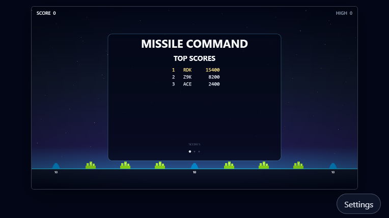
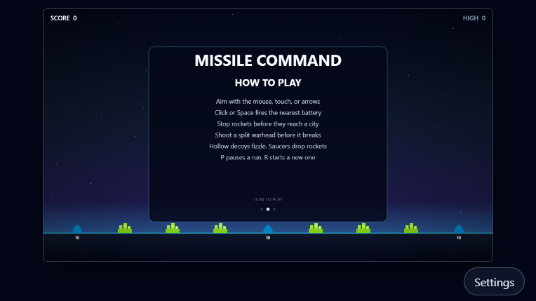
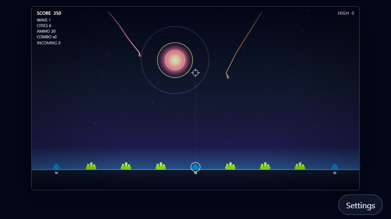
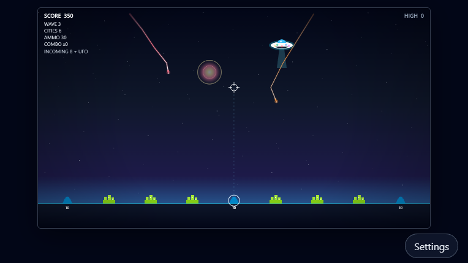
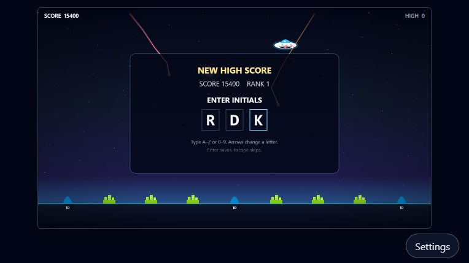

# Zark's Missile Command

An open arcade defense game inspired by the 1980 classic. Defend six cities from incoming rockets, chase a combo, and leave three initials on the local board. Everything on screen and in the speakers is drawn or synthesized in the browser. No borrowed game assets.

Contributions are welcome.

## Screenshots

| Scores | How to play |
| --- | --- |
|  |  |

| In a wave | Saucer |
| --- | --- |
|  |  |

A qualifying run asks for three letters or digits, the way an old cabinet did.



## Play locally

```bash
npm install
npm run check
npm run dev
```

Open the URL Vite prints. Click the page once so the browser will allow sound.

`npm run check` simulates the rules in Node. It does not boot a browser. `npm run build` writes a static build to `dist/`.

## Controls

- Mouse, touch, or arrows / WASD: aim. Hold Shift to aim slowly.
- Click, tap, or Space: fire from the nearest battery that still has ammo.
- `P` or `Esc`: pause / resume.
- `R`: start a new run.
- `M`: mute.
- `C`: colorblind palette.
- `N`: reduced motion.
- `V`: modern / retro look.
- `F1`: settings.
- On the title screen, left and right arrows change the page.

The title screen rotates through top scores, how to play, and how to start. Click or press Space to play.

## Gameplay

- Six cities sit between three batteries. A rocket destroys only the target it was aimed at, and only if it lands close.
- Intercepts build a combo, up to 3x. Losing a city or battery clears it.
- From wave 2, split warheads break apart. Shooting the parent is worth more than cleaning up the pieces.
- Fast rockets, weaving rockets, and hollow decoys each have their own sound. Decoys fizzle if you ignore them.
- Odd waves from wave 3 send a saucer. It hums as it crosses and drops rockets.
- Surviving cities, leftover ammo, and peak combo pay a wave bonus. Batteries reload after the wave.
- When every city is gone, a top-8 score can be saved with three alphanumeric initials. The board stays in this browser.

## Contributing

Issues and pull requests are open. Useful places to start:

- Feel and balance live in `src/game/constants.js`.
- Rules live in `src/game/update.js`. Add a failing case to `scripts/sim-check.mjs` before changing them.
- Drawing lives in `src/game/render.js`. Sound lives in `src/game/audio.js`.

Run `npm run check` before opening a pull request. Please do not add copyrighted sprites, audio, or claim this is an official port.

## Layout

- `src/game/constants.js` — config
- `src/game/state.js` — state, defenses, initials, local board
- `src/game/input.js` — pointer and keyboard
- `src/game/update.js` — simulation
- `src/game/render.js` — canvas
- `src/game/loop.js` — fixed step
- `src/game/audio.js` — synthesized SFX
